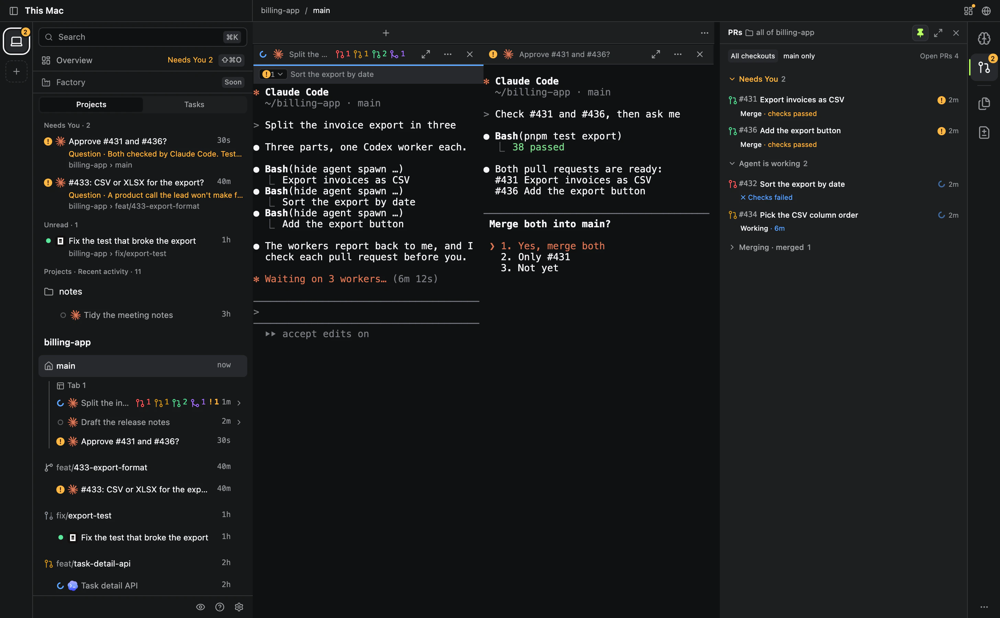
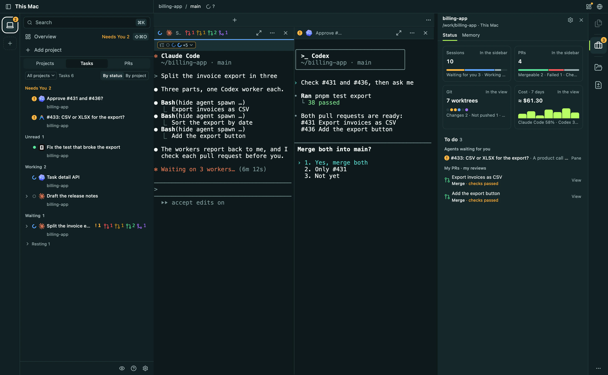
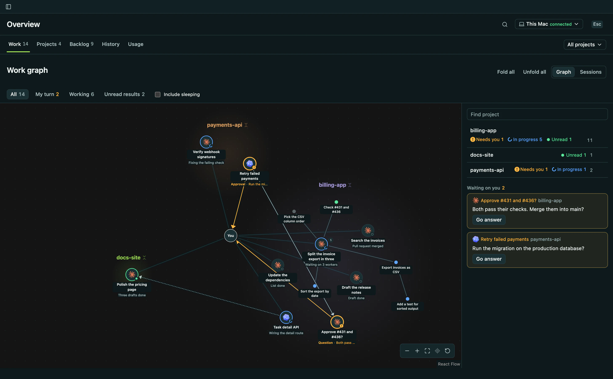
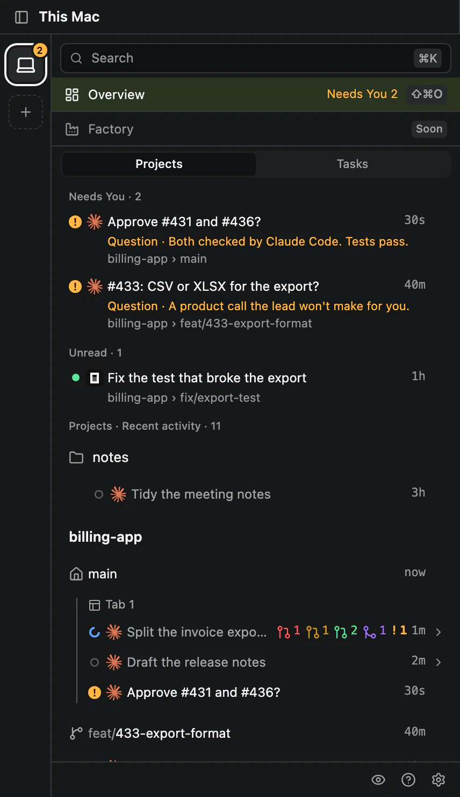
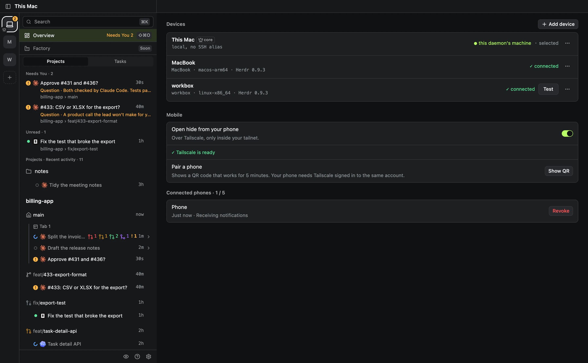

<p align="center">
  
</p>

<h1 align="center">hide</h1>

<p align="center">
  <strong>Run more agents. Hold less.</strong><br>
  The multi-agent IDE for Claude Code, Codex and whatever comes next.
</p>

<p align="center">
  <a href="https://github.com/with-hide/hide/releases/latest"></a>
  <a href="LICENSE"></a>
  
  <a href="https://herdr.dev"></a>
</p>

<p align="center">
  <a href="https://withhide.dev"><strong>Download</strong></a> ·
  <a href="https://withhide.dev">Website</a> ·
  <a href="docs/README.md">Docs</a> ·
  <a href="https://github.com/with-hide/hide/discussions">Discussions</a> ·
  <a href="CONTRIBUTING.md">Contributing</a>
</p>

<p align="center">
  <picture>
    <source media="(prefers-color-scheme: light)" srcset="site/assets/shots/hero-light.webp">
    
  </picture>
</p>

You run several coding agents at once, and someone has to keep track of them.
hide puts every agent, task and pull request in one view, lets the agents start, watch and write to each other, and brings up only what needs a person.
Close the laptop and the work keeps going.

It works with the agent CLIs you already signed in to: no new API key, no hosted service.

<p align="center">
  <kbd>Claude Code</kbd> <kbd>Codex</kbd> <kbd>Antigravity</kbd> <kbd>OpenCode</kbd> <kbd>Grok</kbd> <kbd>Pi</kbd> <kbd>omp</kbd>
</p>

> [!TIP]
> **Already on Herdr?** hide is built on [Herdr](https://herdr.dev) and opens on the server you already run, so your workspaces, panes and agents are there on first launch.
> It never replaces your server on its own; when yours is an older Herdr, hide offers to move it to its own, a live handoff on macOS and Linux that keeps your panes running.
> No Herdr yet? hide brings its own.

## Features

### Every agent at a glance

The sidebar shows the same work three ways: **Projects** as a tree of checkouts and the agents in them, **Tasks** grouped by who acts next, and **Pull requests** sorted by what waits on you.
The Project tool beside your agents counts the project's sessions, pull requests, worktrees and the last seven days' cost, and lists what is yours to do.
The Overview draws the whole night as one map: which agent started which, the letters between them, and who is waiting on you.

<table>
  <tr>
    <td width="50%"><picture><source media="(prefers-color-scheme: light)" srcset="site/assets/shots/tasks-light.webp"></picture></td>
    <td width="50%"><picture><source media="(prefers-color-scheme: light)" srcset="site/assets/shots/map-light.webp"></picture></td>
  </tr>
  <tr>
    <td align="center"><sub>Tasks, grouped by who acts next</sub></td>
    <td align="center"><sub>The Overview map of who started whom</sub></td>
  </tr>
</table>

### Agents start, watch and write to each other

A lead starts workers, a worker starts a helper, on this machine or another, and they write to each other in letters.
Mix vendors freely: one agent writes, another checks.
A child runs in its own tab and reports to its parent, not to you.
The agent that started a child watches it: it hears within a minute when the child stops on a question, and after 20 quiet minutes when it stalls.
Claude Code and Codex can end a turn and wait; the letter they wait for wakes them.
For a set of pull requests, a Conductor agent runs a **mission**: it plans the work, starts the workers and reports back.

### Hide AI does the reading

Hide AI reads what each agent did and writes what a person needs: a title, why it stopped, what you asked and what you missed.
Agents sort themselves into **Needs You, Unread, Working and Seen**, and the ones waiting on you sit on top of every screen.
**Project Memory** turns what you decide in a session into a card, checks it against the repository and hands it to the next agent, whichever vendor runs it; a rule worth keeping comes back as one pull request to your docs.
Hide AI runs on the agent CLI you already signed in to, and every status still works with it switched off.

<p align="center">
  <picture>
    <source media="(prefers-color-scheme: light)" srcset="site/assets/shots/attention-light.webp">
    
  </picture>
</p>

### Your agent drives the browser

An agent opens the page it changed beside its pane, clicks through it and reads what it shows, so it checks its own work before it asks you.
A file or diff it names opens next to it too.

```sh
hide browser open localhost:5173/invoices             # a page beside the agent's pane
hide browser snapshot browser-1 --interactive          # the page as numbered elements
hide browser click browser-1 --text "Export CSV"       # click, fill, type, press, drag, screenshot
hide file open src/export/csv.ts                       # the file it changed, in the editor beside it
```

### One core, any screen

Put hide's core on a machine that never sleeps.
Projects, letters and titles live there; your laptop becomes a screen, so closing it stops nothing.
Add any machine by its SSH alias and its agents join the same lists, and pair your phone by QR to answer the one that needs you, over your own Tailscale.

<p align="center">
  <picture>
    <source media="(prefers-color-scheme: light)" srcset="site/assets/shots/core-light.webp">
    
  </picture>
</p>

### Still an IDE

- **Real terminals.** Agents run in Herdr panes with their real layout, scrollback and focus, drawn in place.
- **Files and diffs.** An editor with a VS Code style Explorer, and each checkout's changes one click from its tab.
- **A worktree per task.** GitHub issues and local notes sit in one backlog; starting one opens a worktree, an agent and its first prompt.
- **Pull requests.** The ones waiting on you come first, and one click hands a pull request to an agent.
- **Keyboard first.** `⌘K` goes to any agent, task, issue or pull request, and `⌘P` opens any file.
- **Guardrails.** Guard the base branch, working folders, files and risky Git commands, per project.
- **Limits and cost in view.** How much of each agent's week is left, and each project's last seven days at API prices.

> [!NOTE]
> **Software Factory is coming.** Queue issues with clear requirements; workers take them in order, verify and merge them, and bring back only what needs a person.
> Email [hello@withhide.dev](mailto:hello@withhide.dev) to join the list, or watch this repository's releases.

## Your agents drive hide too

hide installs a skill and hooks into each agent, so an agent can do from its pane what you do from the window.

```sh
hide agent spawn --parent here --name export-csv --intent export-csv --kind codex \
  --repo ~/billing-app --branch feat/export-csv --brief "Export invoices as CSV"   # a worker it watches
hide request send <agent> --intent review --body "Check #431 before I merge"   # a letter to another agent
hide mission help                                                     # plan and run a set of pull requests
hide device add workbox                                               # another machine, by SSH alias
```

`hide guide` prints how an agent works inside hide, and `hide --help` lists every command.

## Start with one task

1. Install hide from [withhide.dev](https://withhide.dev) or the [latest release](https://github.com/with-hide/hide/releases/latest), and sign in to the agent CLIs you use.
2. Add a project, start an agent and give it a task; ask it to split the work across a few workers.
3. Watch the sidebar's Tasks list and the Overview map, and answer only what reaches **Needs You**.

## Install

[withhide.dev](https://withhide.dev) picks the installer for your system, or download it from the [latest release](https://github.com/with-hide/hide/releases/latest):

| System | Package | First launch |
| --- | --- | --- |
| macOS 14+, Apple Silicon | `hide-v<version>-macos-arm64.dmg` | Drag hide to Applications; it opens like any app |
| Windows x64 | `hide-v<version>-windows-x64-setup.exe` | Installs for you only; unsigned, so SmartScreen asks once: **More info**, **Run anyway** |
| Debian, Ubuntu (x64) | `hide-v<version>-linux-x64.deb` | `sudo apt install ./hide-v<version>-linux-x64.deb`, then hide is in the app menu |
| Fedora and other rpm systems (x64) | `hide-v<version>-linux-x64.rpm` | `sudo dnf install ./hide-v<version>-linux-x64.rpm`, then hide is in the app menu |

Check the installer against its `.sha256` file before you open it.
After that one install, hide updates itself.
Install and sign in to the agent CLIs you want hide to start; hide never asks for their credentials.
hide brings its own [Herdr](https://herdr.dev), and when a Herdr server is already running it opens on top of it as it is.

[Install hide](docs/INSTALL.md) covers checksums, Gatekeeper, each system's steps, updates, uninstalling and troubleshooting, and [What each system supports](docs/INSTALL.md#what-each-system-supports) records where each system stands.

<details>
<summary><strong>Build from source</strong></summary>

<br>

You need Rust with 2024 edition support, Node.js 22.12.0 or later and pnpm 10.

```sh
git clone https://github.com/with-hide/hide.git
cd hide
pnpm install --frozen-lockfile
HIDE_VERSION=0.0.0-local pnpm --dir desktop package
```

On macOS this writes an ad-hoc signed `hide.app` under `desktop/out/`, and the dmg, the zip the updater reads, their SHA-256 files and the update file under `desktop/out/release/`; install the app with:

```sh
sudo /usr/bin/ditto --rsrc --extattr --qtn desktop/out/hide-darwin-arm64/hide.app /Applications/hide.app
open /Applications/hide.app
```

`0.0.0-local` marks a local build; set the version you mean when packaging any other.
Windows and Linux source builds are in [Build and install from source](docs/INSTALL.md#build-and-install-from-source).

To look at hide in a browser without installing the app, `bash scripts/web-dev.sh` builds the daemon, starts it with the pinned Herdr and opens the address ([Try hide in a browser](docs/INSTALL.md#try-hide-in-a-browser)).

</details>

## Your machines, your sign-ins

- **Nothing hosted.** The app, the core and Hide AI run on machines you own, so your code goes only where your agent CLIs already send it.
- **Credentials stay with their tools.** Agent CLIs, SSH and Herdr keep their own sign-in state.
  The one thing hide reads is Codex's `auth.json` access token and account ID, which it sends to Codex's usage endpoint to show your usage.
- **Your Herdr is left alone.** A Herdr server that answers is used as it is and never stopped or replaced; when none answers, hide starts its bundled one, which keeps running after the app quits.
- **Your phone stays in your tailnet.** It reaches your machines over your own Tailscale.

## How it works

```text
Herdr server ─ panes, terminals and agent lifecycle
     │  versioned snapshots + terminal output
     ▼
herdr-core (Rust) ─ the one owner of hide's state
     │  typed events in, snapshot deltas out
     ▼
hided ─ the daemon and the `hide` CLI: loopback HTTP + a token WebSocket
     │
     ▼
web shell (React) ─ in the Electron app, or a browser on the same machine
```

The core owns the state behind one snapshot boundary, and the shell only renders it and sends user events back, so the screen never keeps a competing model of the session.
[ARCHITECTURE.md](docs/ARCHITECTURE.md) explains the boundaries and their reasons.

### Built on Herdr

<!-- herdr-provenance:start -->
hide distributes the [upstream Herdr release v0.9.5](https://github.com/herdrdev/herdr/releases/tag/v0.9.5).
The bundled binary's code is not modified by hide; a macOS release replaces only its ad-hoc signature with hide's Developer ID one, which notarization requires.
The daily `herdr-update.yml` workflow proposes upstream stable releases with `--repo herdrdev/herdr`; updates must pass contract and runtime checks.
<!-- herdr-provenance:end -->

## Performance

<details>
<summary><strong>What one machine measured</strong></summary>

<br>

On an M4 Pro Mac, the 2026-10-04 candidate measured **16.3 ms p95** from a renderer keydown to a complete nine-character echo in the terminal buffer, and its whole process tree held **549 MiB** idle and **622 MiB** with three busy terminals (RSS p95).
These are one machine's numbers on macOS, taken without quiescing it: they leave out key-to-photon latency and Windows and Linux, and no other app ran the same workload, so they claim nothing about relative speed.
[PERFORMANCE_RESULTS.md](docs/PERFORMANCE_RESULTS.md) has the method, the distributions and every limit.

</details>

## Documentation

| Guide | What it covers |
| --- | --- |
| [Install](docs/INSTALL.md) | Releases, source builds, devices, moving the core, updates and troubleshooting |
| [UI behavior](docs/UI_BEHAVIOR.md) | What every screen does |
| [Status model](docs/status-model.md) | How an agent's group and read state are decided |
| [Agent hooks](docs/agent-hooks.md) | What hide writes for each agent, and where |
| [Browser displays](docs/BROWSER_DISPLAYS.md) | `hide browser` and the pages drawn beside the work |
| [Architecture](docs/ARCHITECTURE.md) | The core, the daemon, the desktop host and the Herdr boundary |
| [All docs](docs/README.md) | Every current guide and what owns it |

## Contributing

hide is built in the open.
Report a bug you reproduced with the [bug form](https://github.com/with-hide/hide/issues/new?template=bug.yml) and bring ideas to [Discussions](https://github.com/with-hide/hide/discussions/categories/ideas).
Pull requests are open only to maintainers and the people in [`.github/APPROVED_CONTRIBUTORS`](.github/APPROVED_CONTRIBUTORS); others are closed automatically.
[CONTRIBUTING.md](CONTRIBUTING.md) owns that policy and lists the `verify` gates and their local commands, and [AGENTS.md](AGENTS.md) holds the rules every change follows.

```sh
pnpm install --frozen-lockfile
bash scripts/verify-cargo.sh test   # Rust suites
bash scripts/verify-web.sh          # web and desktop typecheck, lint, test and build
pnpm --dir desktop dev              # the desktop app, unpackaged, against this checkout's build
```

<details>
<summary><strong>Repository map</strong></summary>

<br>

| Path | What lives there |
| --- | --- |
| `desktop/` | The Electron desktop host, the app that ships |
| `web/` | The React web shell |
| `hided/` | The daemon and the `hide` CLI |
| `herdr-core/` | The platform-neutral Rust runtime that owns hide's state |
| `hide-platform/` | What differs between macOS, Windows and Linux, written once |
| `hide-agent-hooks/` | The only code that writes an agent's configuration file |
| `hide-ai/` | Background AI features on the operator's own agent CLIs |
| `hide-kit/` | The install kit and every path under `~/.hide` |
| `hide-*/` | The other supporting crates: sessions, memory, devices, projects |
| `plugins/` | Herdr plugins shipped from this repository |
| `contracts/` | The pinned Herdr API contract |
| `design/` | The Pen design library and `tokens.json` |
| `site/` | [withhide.dev](https://withhide.dev) |

</details>

## Community and support

- **Questions:** [Discussions Q&A](https://github.com/with-hide/hide/discussions/categories/q-a)
- **Ideas and feature requests:** [Discussions Ideas](https://github.com/with-hide/hide/discussions/categories/ideas)
- **Bugs you reproduced:** [the bug form](https://github.com/with-hide/hide/issues/new?template=bug.yml); issues are only for reproduced bugs
- **Security:** report privately as [SECURITY.md](SECURITY.md) describes, never in a public issue
- **Teams and everything else:** [hello@withhide.dev](mailto:hello@withhide.dev)

## License

hide is licensed under the [Apache License 2.0](LICENSE); [NOTICE](NOTICE) carries its copyright notice.
The bundled Herdr and other third-party components keep their own licenses, listed in [THIRD_PARTY_NOTICES](desktop/resources/THIRD_PARTY_NOTICES).
